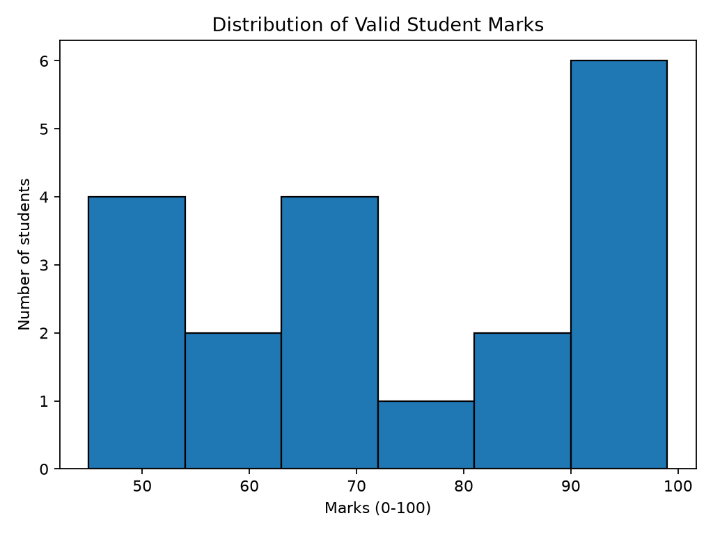
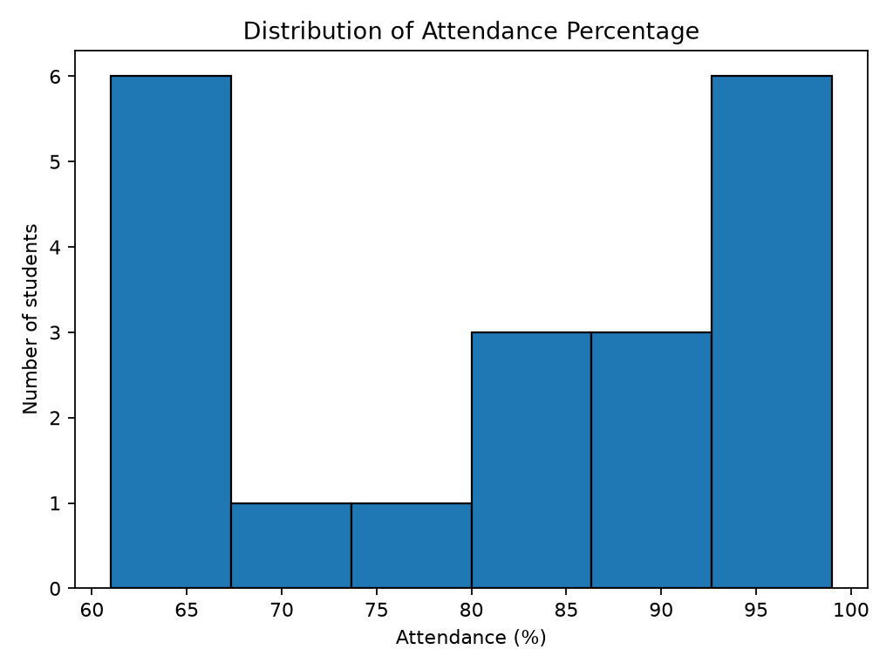
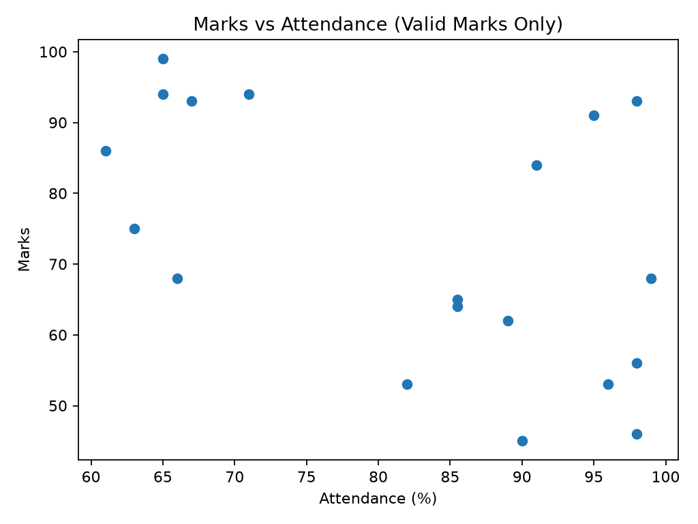
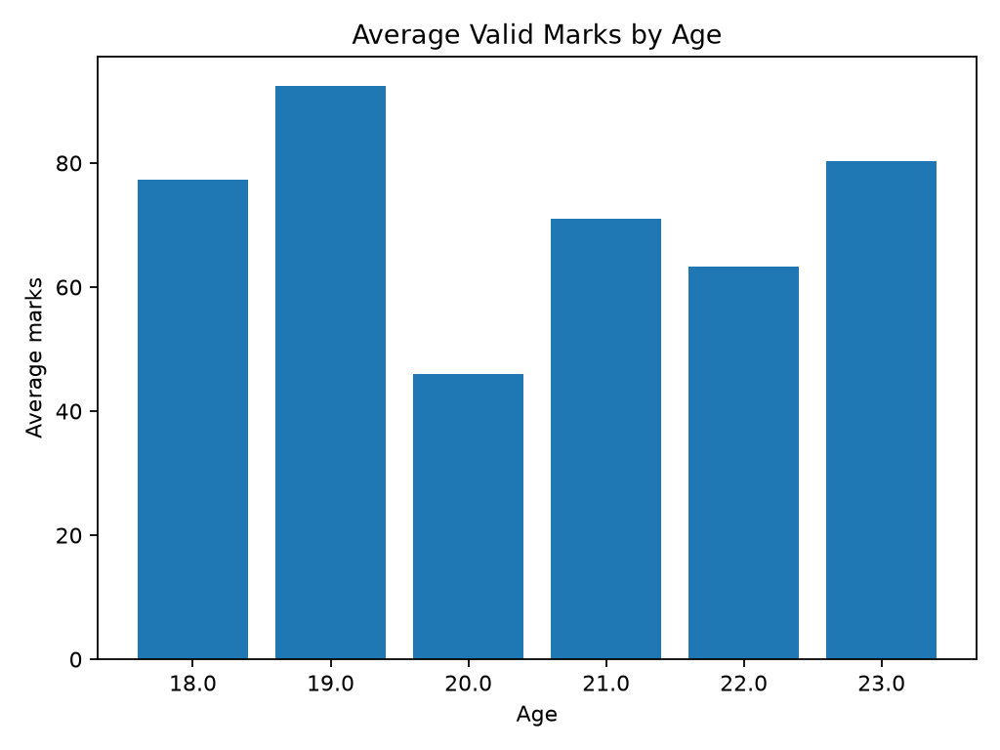
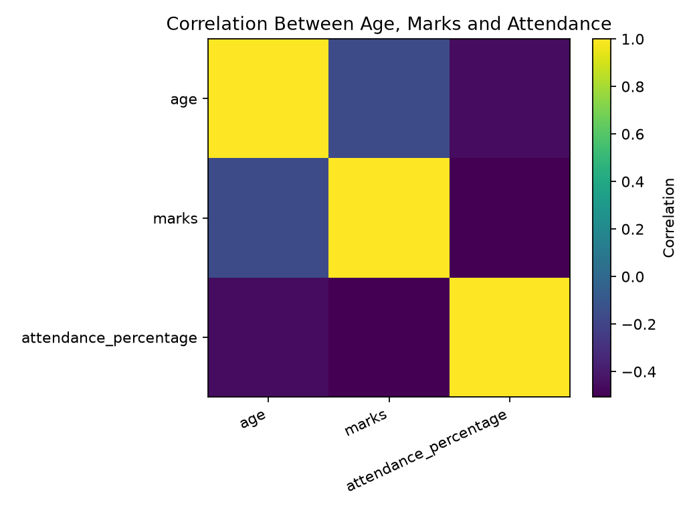

# SWYNEX Data Analysis Internship — Task 2: Exploratory Data Analysis

**Author:** Priyada Kishor Mangaonkar

## Project Overview

This project focuses on performing Exploratory Data Analysis (EDA) on a cleaned student dataset using Python, Pandas, and Matplotlib.

The objective is to analyze student data, calculate descriptive statistics, identify patterns and anomalies, visualize relationships between variables, and extract meaningful insights.

## Dataset

The dataset contains 20 student records and the following five columns:

- `student_id` — Student identifier
- `name` — Student name
- `age` — Student age
- `marks` — Student marks
- `attendance_percentage` — Student attendance percentage

## Tools and Technologies

- Python
- Pandas
- Matplotlib
- Visual Studio Code
- GitHub

## Analysis Performed

- Dataset overview and data type inspection
- Missing-value analysis
- Descriptive statistical analysis
- Data quality and anomaly checks
- Marks distribution analysis
- Attendance distribution analysis
- Marks versus attendance analysis
- Average marks comparison by age
- Correlation analysis

## Data Visualizations

### 1. Distribution of Student Marks

This histogram displays the distribution of valid student marks and helps understand variations in student performance.



### 2. Distribution of Attendance Percentage

This histogram illustrates the distribution of attendance percentages among students.



### 3. Marks vs Attendance

This scatter plot explores the relationship between student marks and attendance percentage. The invalid marks value is excluded from this visualization.



### 4. Average Marks by Age

This bar chart compares average valid marks across different age groups.



### 5. Correlation Heatmap

This heatmap visualizes the correlations between age, marks, and attendance percentage, excluding the invalid marks value.



## Key Insights

1. **Student performance varies:** Valid marks range from 45 to 99. The average marks are 73.11 after excluding the invalid value of -10.

2. **Attendance is relatively high overall:** Average attendance is 82.05%, while median attendance is 85.5%.

3. **An invalid marks value was identified:** One record contains marks of -10, which falls outside the expected 0–100 range. This value should be verified against the original source.

4. **High marks do not always correspond to high attendance:** Student_20 scored 99 marks with 65% attendance. This illustrates that high marks and high attendance do not always occur together in this dataset.

5. **A repeated student name requires investigation:** Student_1 appears under two different student IDs. This may be a naming issue, so the records should be verified rather than automatically deleted.

6. **Marks and attendance show a negative correlation:** After excluding the invalid marks value, the correlation is approximately -0.506. This indicates a negative linear association in this small sample; it does not establish that attendance causes lower marks.

## Project Structure

```text
Task2-EDA/
├── data/
│   └── cleaned_student_data.csv
├── charts/
│   ├── marks_distribution.png
│   ├── attendance_distribution.png
│   ├── marks_vs_attendance.png
│   ├── average_marks_by_age.png
│   └── correlation_heatmap.png
├── reports/
│   ├── descriptive_statistics.csv
│   ├── data_quality_checks.csv
│   ├── correlation_matrix.csv
│   └── eda_insights_report.txt
├── eda_analysis.py
└── README.md
```

## How to Run the Project

1. Download or clone the repository.
2. Open the `Task2-EDA` folder in Visual Studio Code.
3. Install the required libraries:

   ```bash
   python -m pip install pandas matplotlib
   ```

4. Run the analysis script:

   ```bash
   python eda_analysis.py
   ```

5. Open the `charts` folder to view the visualizations and the `reports` folder to view the statistical results.

## Conclusion

This project demonstrates how Python-based Exploratory Data Analysis can be used to summarize data, visualize distributions, investigate relationships, and identify data quality issues.

The analysis highlights the importance of validating unusual values and interpreting statistical findings carefully before drawing conclusions.

## Author

**Priyada Kishor Mangaonkar**

Computer Engineering Student

GitHub: [mangaonkarpriyada-code](https://github.com/mangaonkarpriyada-code)

---

*Completed as part of the SWYNEX Data Analyst Internship — Task 2: Exploratory Data Analysis.*